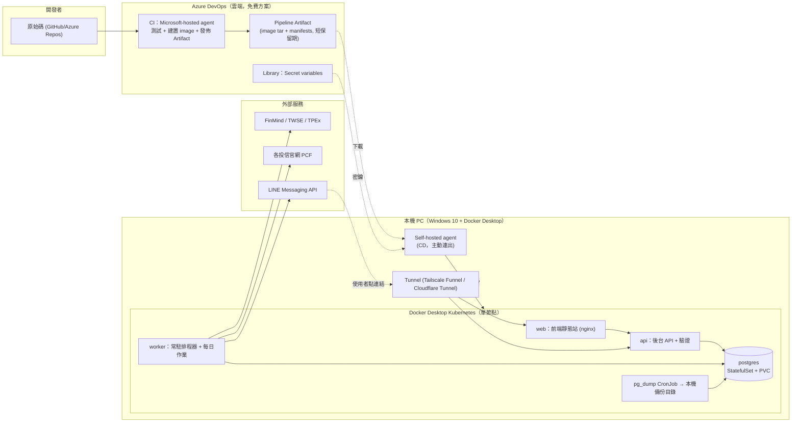
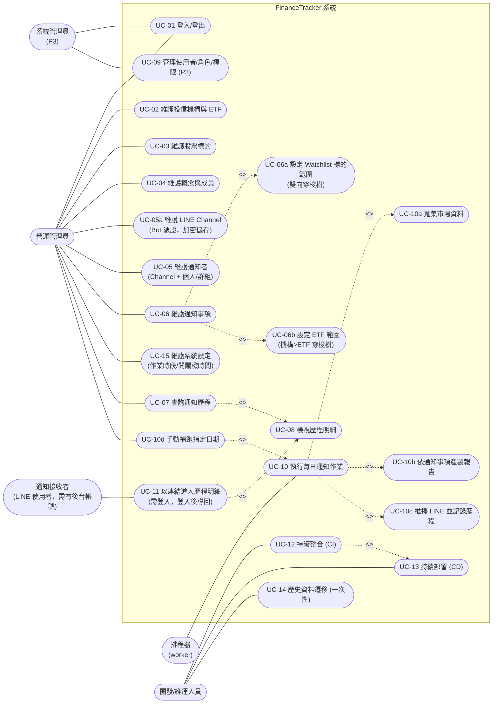
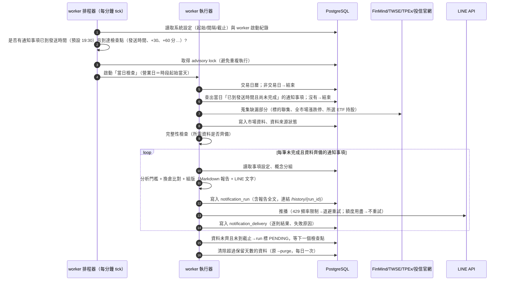
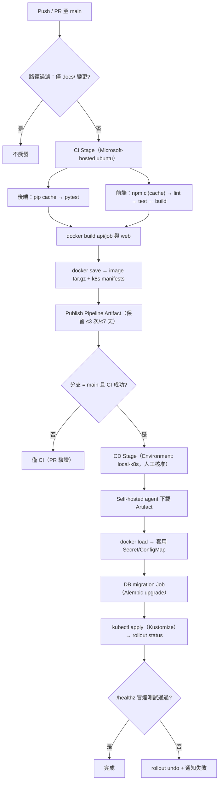
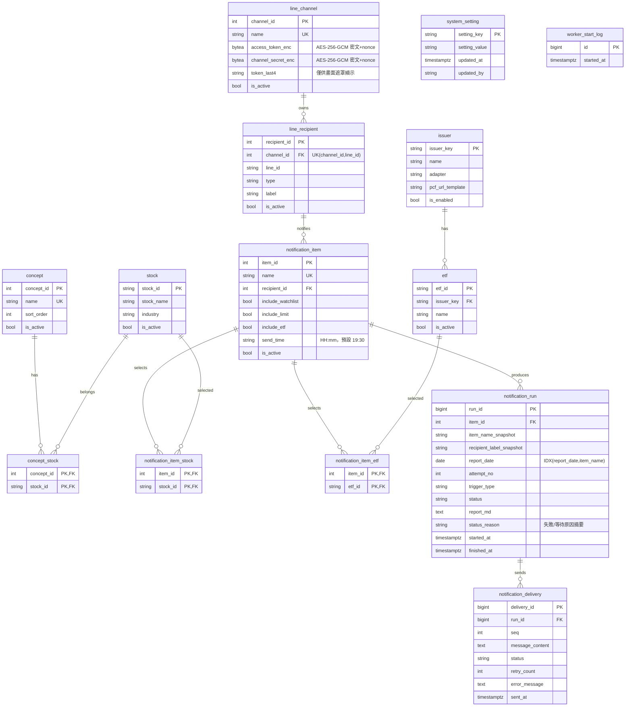
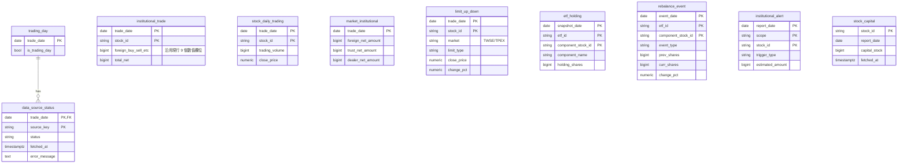
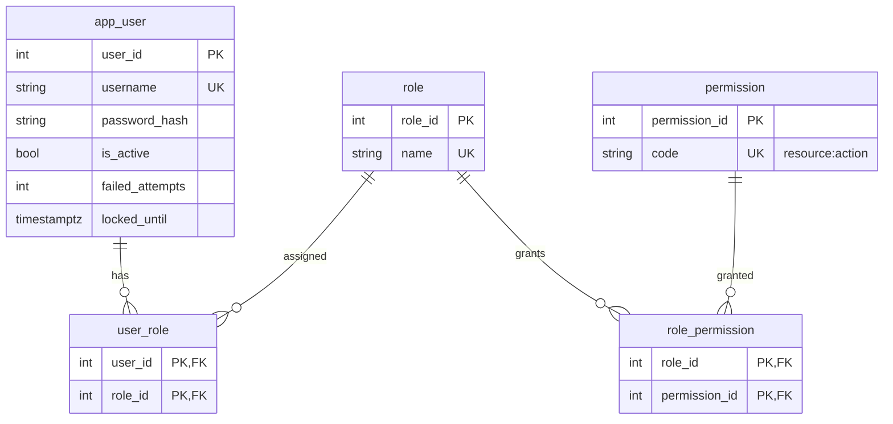

# SA-後台管理介面與微服務化擴增-功能模組分析

## 0. 文件資訊與需求摘要

| 項目 | 內容 |
| :--- | :--- |
| 文件類型 | 系統分析（功能模組分析）文件 / SA 需求規格書（含可行性與成本評估） |
| 分析範疇 | 既有專案 `FinanceTracker`（籌碼監控推播引擎）擴增為：後台管理介面（前端）＋後端 API／排程作業服務＋PostgreSQL，部署於本機 Docker Desktop 內建 Kubernetes，CI/CD 採 Azure DevOps 混合式（雲端 CI＋本地 CD） |
| 對象讀者 | PO / SA / SD / 開發人員 / 維運人員 |
| 建立日期 | 2026-11-09 |
| 作者 | Claude Code（依 Roy Chiang 提供之需求與現行程式碼整理；Azure DevOps 與 LINE 額度已於分析當日查閱官方文件） |
| 分析階段 | 本次僅到**功能模組層級**；資料表 DDL、API 規格、類別圖、K8s manifest 與 pipeline YAML 屬後續 SD 階段 |
| 版本 | v1.2（2026-11-09）：通知事項改為**各自設定發送時間**（預設 19:30）；BIOS 開機時間確定為 04:00；同意 AES-256-GCM 與 `ftops`＋Autologon。v1.1（2026-11-09）：納入使用者對 v1.0 風險與問題的回覆——WSL2 與 Azure 訂閱已就緒；連結需登入並導回；每日開關機時段排程（19:30 起、重試、截止）；LINE Channel 與憑證改由後台維護（**加密儲存，非 SHA-256 雜湊**，見 D-14）；新增系統設定 UC-15；建置步驟另見 [RUNBOOK](./RUNBOOK-本機K8s與Azure-DevOps-Agent建置步驟.md) |
| 前置文件 | [SA-籌碼監控推播引擎-功能模組分析.md](../requirements/SA-籌碼監控推播引擎-功能模組分析.md)、[SD-個股產業與概念分類標籤顯示-系統設計書.md](../../design/architecture/SD-個股產業與概念分類標籤顯示-系統設計書.md)、[SA-每日完整籌碼報告與漲跌停監控-功能模組分析.md](../requirements/SA-每日完整籌碼報告與漲跌停監控-功能模組分析.md) |

### 名詞定義

| 名詞 | 英文/代碼 | 定義 |
| :--- | :--- | :--- |
| 通知者 | LineRecipient | 一個 LINE 推播對象（個人 User 或群組 Group），由 LINE ID 識別；對應現行 `config/recipients.json` |
| 通知事項 | NotificationItem | 一筆「每日推播設定」：選定一位通知者、勾選要啟用的三大區塊、設定各區塊的標的範圍。現行每日一則推播＝1 筆通知事項 |
| 區塊 | Section | 通知內容的三個可勾選單元：①Watchlist 三大法人買賣超 ②今日漲跌停股票 ③ETF 換倉動態 |
| 投信機構 | Issuer | 發行 ETF 的投信（元大、富邦、國泰、群益、野村、統一、安聯、復華、凱基）；每家爬蟲流程不同，**不開放新增**，僅能編輯其底下 ETF |
| 概念 | Concept | 人工維護的概念板塊（如「半導體」「矽晶圓」），對應現行 `config/concept_tags.json`；一檔股票可屬多個概念 |
| 標的 | Stock（Target） | 一檔股票，以代碼＋名稱識別 |
| [未分類] | Uncategorized | 不屬於任何概念的標的，通知與報告中統一歸入此組，固定排在最後 |
| 通知歷程 | NotificationRun / Delivery | 每次實際執行的通知紀錄：Run＝某通知事項某日的一次產製（含完整報告 Markdown）；Delivery＝對通知者的逐則 LINE 發送結果 |
| 雙向穿梭樹 | Tree Transfer | 左側為「概念 → 標的」樹、右側為已選清單，可雙向移動的選取元件 |
| CI / CD | — | CI＝建置與測試（Azure DevOps Microsoft-hosted agent）；CD＝部署（Azure DevOps self-hosted agent 跑在本機） |
| 本機 K8s | Docker Desktop Kubernetes | 本機 Docker Desktop 內建的**單節點** Kubernetes |

### 需求摘要

**現況痛點**：現行系統完全由 JSON 檔（`config/*.json` 設定、`data/` 快照）與 GitHub Actions 排程組成。調整監控標的、概念分類、收訊者、ETF 清單都必須改檔案並 commit；推播的完整報告以 Markdown 存進 git，資料夾逐日膨脹（目前 `data/` 約 9.1 MB／61 個交易日）；沒有任何查詢介面可回顧「某天發了什麼給誰、成功與否」。

**本次要做什麼**：將系統擴增為前後端分離、可獨立部署的服務群，提供後台管理介面維護上述設定，資料全面改存 PostgreSQL，排程改由本機 K8s 內觸發（取代 GitHub Actions cron），並以 Azure DevOps 混合式 CI/CD 交付。

| 子模組 | 核心職責 | 優先級 | 備註 |
| :--- | :--- | :--- | :--- |
| M1 基礎設施與 CI/CD | 本機 K8s、PostgreSQL、Azure DevOps 管線、self-hosted agent、備份 | P0（前置） | 其餘模組的前提 |
| M2 資料庫化與資料遷移 | 將設定檔與歷史快照遷入 PostgreSQL | P0 | 取代 `data/`、`config/*.json` 的執行期角色 |
| M3 基礎資料維護 | 投信機構／ETF、概念、股票標的 | P1 | 後台頁面 |
| M4 通知設定 | LINE Channel（Bot 憑證）、通知者、通知事項（三區塊） | P1 | 後台頁面；改寫現行推播組版邏輯為「依通知事項產製」 |
| M5 通知歷程 | 依日期／名稱查詢、檢視明細（含報告內容） | P1 | LINE 訊息內的連結改指向此明細 |
| M6 排程作業服務 | 本機 K8s 內常駐 worker 依作業時段觸發每日「蒐集→分析→依通知事項產製→推播」 | P1 | 取代 GitHub Actions |
| M7 權限控管 | 使用者 > 角色 > 權限 | P3（可晚做） | 但 P1 必須有「最小登入保護」（見 D-06） |
| M8 系統設定 | 每日作業時段（起始／重試間隔／截止）、預計開關機時間、保留天數、對外網址 | P1 | 與 M6 排程連動（見 D-15、UC-15） |

### 可行性結論（摘要）

**結論：技術上可行；以 Azure DevOps 免費方案運行，用量不會超出，邊際成本預估為 0 元。但有 6 個「條件／風險」必須在動工前處理**（詳見第四章 4.2～4.4）。

| # | 評估面向 | 結論 | 說明 |
| :--- | :--- | :--- | :--- |
| 1 | Azure Pipelines 雲端 CI 額度 | ✅ 足夠 | 免費 1 個 Microsoft-hosted 平行工作＝每月 1,800 分鐘、單次 ≤60 分鐘；本專案估算每月 100～960 分鐘（5%～53%） |
| 2 | 本地 CD 額度 | ✅ 足夠 | self-hosted 免費 1 個平行工作，**無時間限制** |
| 3 | 使用者數 | ✅ 足夠 | Basic 方案前 5 位使用者免費 |
| 4 | Artifact 儲存 | ⚠️ 需控管 | 免費 2 GiB；若把 Docker image tar 當成品傳送，**必須設定短保留期**，否則數週內超出（超出為 $2/GiB/月） |
| 5 | **啟用免費額度的前置條件** | ✅ 已完成（v1.1：Billing 頁顯示訂閱有效） | 官方現行規定：Microsoft-hosted 免費額度**須將組織連結到一個有效 Azure 訂閱（設定 billing）後才會生效**，不是自動給；連結後仍為 0 元，但需要信用卡建立 Azure 訂閱 |
| 6 | 容器映像倉庫 | ⚠️ 設計取捨 | Azure Container Registry **不在免費方案內**（Basic 約每月數美元）；本設計刻意不使用，改用「image 以 tar 作為成品」或「CD 端本機 build」 |
| 7 | **Windows 10 Home 能否跑 Docker Desktop K8s** | ✅ WSL2 已安裝（v1.1，使用者回報）；Docker Desktop／K8s 待實測 | Home 版必須走 WSL2 後端；你稍早 `wsl --install -d Ubuntu` 失敗（0x8000ffff）尚未解決，**必須先讓 WSL2 正常**才能繼續 |
| 8 | LINE 推播額度 | ⚠️ **最大的隱性成本**（v1.1：額度用盡須在歷程明確顯示失敗原因，見 FR-08-6） | 官方規定訊息計量＝**收訊人數**；發到群組時一則訊息會依群組成員數計量。免費額度每月 200 則（台灣現行額度請以 LINE 官方台灣方案頁為準，不同來源說法為 200 或 500）。改為群組通知後極可能超額 |
| 9 | 可用性 | ⚠️ 需接受（v1.1：約 03:00 關機、BIOS 排程開機，改採「時段＋重試」排程，見 D-15） | 單一台 PC＋單節點 K8s，電腦關機／休眠／Docker 未啟動＝當日不推播（GitHub Actions 時代沒有此問題） |
| 10 | 通知連結可達性 | ⚠️ 需處理（v1.1：連結需登入，登入後導回，見 D-09） | LINE 內的歷程明細連結若指向家中 K8s，手機在外網打不開；需 Tunnel（Tailscale Funnel／Cloudflare Tunnel，皆有免費方案） |

> 資料來源（分析當日查閱）：[Azure Pipelines 平行工作文件](https://learn.microsoft.com/en-us/azure/devops/pipelines/licensing/concurrent-jobs)、[Azure DevOps 定價頁](https://azure.microsoft.com/en-us/pricing/details/devops/azure-devops-services/)、[LINE Messaging API pricing](https://developers.line.biz/en/docs/messaging-api/pricing/)、[LINE 訊息計量說明](https://developers.line.biz/en/tips/2026/05/28/how-to-count-messages/)。微軟與 LINE 的額度政策會變動，**開工前請於 Organization settings → Pipelines → Parallel jobs 與 LINE Official Account Manager 再核對一次**。

---

## 一、關鍵設計原則

### 1.1 重大設計決策

| 編號 | 項目 | 結論 |
| :--- | :--- | :--- |
| D-01 | 服務拆分 | 以「**最小可行微服務**」交付 4 個工作負載：`web`（前端靜態站）、`api`（後台 REST API＋驗證）、`worker`（常駐排程器＋蒐集／分析／組版／推播，見 D-07）、`postgres`（StatefulSet＋PVC）。`api` 與 `worker` 共用同一份 Python 程式碼與 image（不同啟動指令），避免過早拆成更多服務；日後需要時再拆。**單機單人系統不建議再細拆**，成本（維運、資源）高於收益 |
| D-02 | 後端技術 | **維持 Python**，採 FastAPI＋SQLAlchemy 2.x＋Alembic（遷移）＋psycopg。理由：現有 8 家投信爬蟲 Adapter、FinMind／TWSE／TPEx 抓取、門檻分析、組版`src/` 約 3,300 行，且 `tests/` 另有 30 餘支測試檔涵蓋各 Adapter，改用 .NET／Node 重寫等於重做所有爬蟲與測試，風險遠大於收益。*註：你的其他專案（BankPro）為 .NET，若偏好 .NET，需自行承擔爬蟲重寫成本，不建議本階段這麼做* |
| D-03 | 前端技術 | **React＋TypeScript＋Vite＋Ant Design**。理由：需求「雙向穿梭樹（概念/標的）」＝Ant Design `Transfer` 官方範例（Tree Transfer）可直接套用；另有表格、分頁、日期選擇、表單檢核等後台元件齊全。替代方案 Vue 3＋Ant Design Vue 同樣有 Tree Transfer 範例，若你較熟 Vue 可替換，成本相近；Element Plus 無原生樹狀穿梭，不推薦 |
| D-04 | 資料庫 | PostgreSQL 16（K8s 內 StatefulSet）。單一資料庫、單一 schema；排程與 API 共用。**不使用 JSON 檔作為執行期資料來源** |
| D-05 | 資料儲存原則 | 市場資料（三大法人、成交量、漲跌停、ETF 持股、換倉事件、大盤法人）與設定資料（機構／ETF／概念／標的／LINE Channel／通知者／通知事項／系統設定）全部入庫；`config/thresholds.json` 之門檻本階段**仍以 ConfigMap 掛載檔案**，因需求未要求後台維護（見 6-Q05）；歷史 `data/` 以一次性腳本匯入後不再 commit 進 git |
| D-06 | 權限策略 | 需求將 RBAC 列為低優先，**但因 LINE 連結需對外可達（見 D-09），P1 必須先有「最小登入保護」**：內建單一管理員帳號（密碼以 PBKDF2-HMAC-SHA256 加鹽雜湊＋JWT；見 D-14）。P3 再擴充為 使用者 > 角色 > 權限；API 從第一天起即以「權限檢查裝飾器」守門（P1 對管理員全放行），P3 只需補資料與管理畫面，不必改所有 API |
| D-07 | 排程（**v1.1 修訂**） | 改採**常駐 `worker` 排程器**（單一副本 Deployment，每分鐘 tick、讀取 DB 內的系統設定，依「作業時段」判斷是否執行），**取代 v1.0 的 K8s CronJob**。原因：使用者要求在後台調整作業起始時間、重試間隔與截止時間，CronJob 的時間寫在 manifest，無法由後台即時調整。以 PostgreSQL advisory lock 確保同一時間只有一個執行者。固定時間且不需後台調整的工作（如 `pg_dump` 備份）仍用 K8s CronJob |
| D-15 | 作業時段與關機配合 | 每日作業採「**發送時間＋重試**」：每筆通知事項各自有**發送時間**（新事項預設 19:30，v1.2），到達該時間後每隔 N 分鐘（預設 30）檢查一次，凡當日已到發送時間且尚未完成的通知事項就執行（已完成者跳過，冪等）；至**截止時間**（預設 02:00）後不再「開始」新執行，且單次執行有逾時上限（預設 30 分鐘）；截止時間必須早於預計關機時間（預設 03:00）一段緩衝，使備份與關機前處理能完成。後台系統設定頁提示並檢核「預計開機／關機時間」與時段的關係（UC-15） |
| D-16 | 每日重啟自動化 | 主機由 BIOS 排程於 **04:00** 開機、Windows 排程約 03:00 關機（每日關機僅約 1 小時；**關機請維持 ≤03:30，若拖到 04:00 附近會與開機時間衝突**）。Windows 10 Home 的 Docker Desktop **必須在使用者登入工作階段內執行**，因此採：專用低權限帳號自動登入（Autologon）→ 登入後自動鎖定螢幕 → Docker Desktop 隨登入啟動 → K8s／Pod 自動恢復 → worker 啟動即檢查是否在時段內並補跑。關機前（預設 02:50）以排程工作先對 PostgreSQL 執行 `CHECKPOINT` 並關閉 Docker Desktop，降低異常斷電造成資料損毀的風險。細節見 RUNBOOK |
| D-08 | 執行管線拆分 | 每日作業分兩階段：**①蒐集（Collect）**＝抓取「所有啟用中通知事項所需標的的聯集」＋全市場漲跌停＋ETF 持股，寫入市場資料表（與通知事項無關、只做一次）；**②依通知事項產製（Per-item）**＝對每筆啟用的通知事項各自分析、組報告、推播、寫歷程。同一份市場資料可供多個通知事項重用，避免重複打外部 API |
| D-09 | 通知連結（**v1.1 修訂**） | LINE 訊息內附「通知歷程明細」連結 `/history/{run_id}`（取代現行 GitHub 報告連結與短網址）。**依使用者決議，連結一律需登入**：外網開啟時若無有效 access token，自動導向登入頁，登入成功後**導回原連結頁面**，不需重新查詢（取代 v1.0 的免登入 share token 方案，簡化設計並縮小暴露面）。對外暴露：若只有你本人檢視，建議以 Tailscale 私有網路（手機安裝 Tailscale，不對公網開放，最安全）；若需讓群組其他成員打開，則用 Tailscale Funnel／Cloudflare Tunnel 並加強登入防護（FR-01-3）。**不在路由器開 Port Forward**。注意：群組內沒有後台帳號的成員無法開啟報告（見 6-Q15） |
| D-10 | 刪除策略 | 股票、概念、通知者、通知事項、ETF 一律**停用／軟刪除**（`is_active`），不做實體刪除，避免歷程失去關聯；歷程表另存名稱快照（通知事項名稱、通知者名稱），設定日後改名不影響舊歷程的呈現 |
| D-11 | 部署成品 | CI 在雲端建置後，**以 `docker save` 將前端與後端 image 壓成 tar 發佈為 Pipeline Artifact**，CD（self-hosted agent）下載後 `docker load` 並 `kubectl apply`。image 以 build number 為 tag，禁用 `latest`；Deployment 設 `imagePullPolicy: IfNotPresent`。**不使用 ACR**（非免費）。備案：CD 端直接以原始碼 artifact 本機 `docker build`，成品體積由 ~300 MB 降至 <5 MB |
| D-12 | CD 通道 | **必須使用 self-hosted agent（由本機主動連出到 Azure DevOps）**，而非由雲端「推送」到本機。家用網路無固定對外位址、無法（也不應）開放 SSH／WinRM／kube-apiserver 對外，agent 只需對外 HTTPS（443）即可 |
| D-13 | 設定來源 | 部署期密鑰（FinMind token、DB 密碼、JWT 金鑰、**憑證主金鑰 `APP_ENCRYPTION_KEY`**）存於 Azure DevOps Library（Secret variable group），由 CD 建立 K8s Secret；**LINE Channel Access Token／Secret 改由後台維護並存入 DB（見 D-14）**，`.env` 內的現行值僅在遷移時作為初始匯入。不使用 Azure Key Vault（付費服務，且無必要） |
| D-14 | 憑證與密碼保護（**需與你確認**） | 你要求 LINE Channel Access Token／Secret 以 SHA-256 存 DB。**SHA-256 是單向雜湊，無法還原**；而推播時必須拿「原文 token」呼叫 LINE API，雜湊後等於 token 永久失效。因此改為：①**LINE Token／Secret → AES-256-GCM 可逆加密**後存 DB，主金鑰放 K8s Secret（不入 DB、不入版控）；畫面為「只寫不讀」（儲存後僅顯示「已設定，末 4 碼」，只能整組重新輸入覆寫）。②**使用者密碼 → 單向雜湊**，採 **PBKDF2-HMAC-SHA256（加鹽、≥60 萬次迭代）**，符合「SHA256」字面且對密碼是正確做法（單純 SHA-256 運算過快，易被暴力破解，不建議）；或 Argon2id。③**備份注意**：DB 備份檔不含主金鑰，主金鑰必須另行保管（遺失＝需重新輸入所有 LINE 憑證） |

### 1.2 技術選型比較（支撐 D-02／D-03）

| 面向 | 選項 | 優點 | 缺點 | 建議 |
| :--- | :--- | :--- | :--- | :--- |
| 後端 | **Python FastAPI** | 100% 重用現有爬蟲／分析／組版與測試；自動產生 OpenAPI；async 與 Pydantic 檢核成熟 | 需補 ORM／遷移層 | ✅ 採用 |
| 後端 | .NET 8 Web API | 你工作熟悉；強型別 | 8 家投信爬蟲（含 BeautifulSoup 解析、Excel、JSON 各式格式）與全部測試需重寫，工期數倍 | ❌ 本階段不採 |
| 後端 | Node／NestJS | 與前端同語言 | 同樣需重寫全部爬蟲 | ❌ |
| 前端 | **React＋Ant Design** | Tree Transfer、Table、Form 一應俱全；生態最大 | 學習曲線較高 | ✅ 採用 |
| 前端 | Vue 3＋Ant Design Vue | 較易上手；同樣有 Tree Transfer | 生態略小 | 備選 |
| DB | **PostgreSQL** | 需求指定；JSONB、全文檢索（歷程模糊搜尋可用 `ILIKE`／`pg_trgm`） | — | ✅ |
| 部署 | **原生 manifest＋Kustomize** | Docker Desktop 內建 `kubectl`，免額外安裝；單一環境足夠 | — | ✅ 採用（Helm 對單環境過重） |

### 1.3 建議分階段交付

| 階段 | 內容 | 完成判準 |
| :--- | :--- | :--- |
| Phase 0：環境 | 修復 WSL2、安裝 Docker Desktop、啟用 K8s、安裝 self-hosted agent、建立 Azure DevOps 組織與免費額度、Tunnel 實測 | 能用 pipeline 部署 Hello World 到本機 K8s 並由外網開啟 |
| Phase 1：資料與作業 | M2 DB 與遷移、M6 排程作業（先「行為等價」搬到 DB）、M1 CI/CD 完整化 | 與現行 GitHub Actions 並行 3 個交易日，推播內容一致（並行期間僅一邊發 LINE） |
| Phase 2：後台 | M3 基礎資料、M4 通知設定、M5 通知歷程、最小登入 | 全部 UC-02～UC-08 驗收通過；LINE 連結可開啟歷程明細 |
| Phase 3：權限 | M7 使用者／角色／權限 | UC-09 驗收通過 |
| Cutover | 停用 GitHub Actions cron、`data/` 加入 `.gitignore` | 連續 5 個交易日正常 |

---

## 二、現行系統分析（As-Is）

### 2.1 現況

| 面向 | 現況 | 痛點／缺口 |
| :--- | :--- | :--- |
| 排程 | `.github/workflows/daily-chip-monitor.yml`：週一至五 UTC 12:00（台灣 20:00）；三步驟 `--skip-notify` → `--purge` → `--notify-only`。另有本機 `docker/crontab`＋`docker/entrypoint.sh` 的 scheduler 容器版本（不回寫版控） | 設定異動需改檔＋commit；本機排程版無報告連結 |
| 設定 | `config/watchlist.json`（stocks/brokers/etfs）、`concept_tags.json`（概念→成員）、`recipients.json`（LINE ID）、`issuer_registry.json`（9 家投信、`isEnabled`、ETF 清單、Adapter、URL）、`thresholds.json` | 無介面；無異動紀錄；概念只能手改 JSON |
| 資料儲存 | `data/snapshots/{date}/*.json`、`data/reports/{date}/*.json,*.md`、`data/reference/capital_stock/`、`data/tags/industry_tags.json` | 檔案散落；無法查詢；每日 commit 造成 git 膨脹（`.git` 3.7 MB、`data` 9.1 MB，目前僅 61 日，一年約 55 MB） |
| 推播 | `Notifier`＋`MessageFormatter`：大盤法人＋個股買賣超（門檻篩選）＋ETF 換倉；超過 4,500 字自動分頁、單日上限 10 則；紀錄寫入 `notification_log.json` | 內容固定三塊、不能依對象客製；紀錄只能翻檔案 |
| 報告 | `ReportGenerator` 產出 `daily_report.md` 並 commit，LINE 附 GitHub 連結（經 `LinkPublisher` 縮網址） | 報告住在 git；私有 repo 的連結對他人不可讀 |
| 漲跌停 | `LimitScanner` 掃上市＋上櫃，`MarketType` 已區分 TWSE／TPEX | 報告表格含市場欄位，但**未依市場分組排序** |
| 概念顯示 | `group_by_first_concept`：以「第一個概念」分組，無概念者歸「未分類」排最後 | 概念順序取決於 JSON 順序，無明確排序欄位 |
| 清除 | `--purge` 依 `snapshot_retention_days`（365）刪過期目錄 | 入庫後需改為資料列清除 |

### 2.2 可複用的現行機制（沿用，不重寫）

| 機制 | 現行元件 | To-Be 用途 |
| :--- | :--- | :--- |
| 投信 PCF 爬蟲 | `src/issuer_pcf/*`（9 家 Adapter＋`registry.py`） | 完全沿用；`issuer_registry.json` 內的 Adapter／URL 範本仍留在程式／ConfigMap，**後台只維護 ETF 清單與啟用狀態** |
| 外部資料抓取 | `FinMindClient`、`Fetcher`、`market_quote/twse.py|tpex.py` | 沿用；輸出由「寫 JSON」改為「寫 Repository（DB）」 |
| 分析邏輯 | `InstitutionalTieredFilter`、`MarketInstitutionalFilter`、`RebalanceClassifier`、`LimitScanner` | 沿用，不改判斷規則 |
| 分類與分組 | `classification.py`（`group_by_first_concept`、`build_classification_tags`） | 沿用；概念資料來源改為 DB |
| 組版與分頁 | `MessageFormatter`（含 4,500 字分頁）、`ReportGenerator` | 沿用並改為「以通知事項的勾選與標的範圍為輸入」；報告 Markdown 存入 DB |
| LINE 發送與重試 | `LineClient`、`Notifier._push_with_retry`、每日 10 則上限 | 沿用；紀錄改寫入 `notification_delivery` |
| 資料存取抽象 | `SnapshotRepository`（所有讀寫集中於此） | **關鍵接縫**：保留同名方法介面，新增 PostgreSQL 實作，可讓上層模組與既有測試改動降到最低 |
| 測試資產 | `tests/`（fixtures＋各 Adapter 測試） | 沿用；Repository 層新增針對 DB 的測試 |
| 容器基礎 | `Dockerfile`（python:3.11-slim、TZ=Asia/Taipei）、`docker-compose.yml` | 作為 `api`/`worker` image 基底；compose 保留給本機開發 |

### 2.3 現行檔案 → To-Be 資料表對照

| 現行來源 | To-Be 去向 |
| :--- | :--- |
| `config/issuer_registry.json` | `issuer`（固定種子）＋`etf`（可維護） |
| `config/watchlist.json` stocks／etfs | 轉為預設「通知事項 #1」的選取標的（`notification_item_stock`／`notification_item_etf`）；`brokers` 分點功能維持停用，不入庫 |
| `config/concept_tags.json` | `concept`＋`concept_stock`＋`stock` |
| `config/recipients.json` | `line_recipient` |
| `config/thresholds.json` | 本階段維持 ConfigMap（見 6-Q05） |
| `data/snapshots/*` | `institutional_trade`、`stock_daily_trading`、`market_institutional`、`limit_up_down`、`etf_holding`、`trading_day`／`data_source_status` |
| `data/reports/*` | `institutional_alert`、`rebalance_event`、`notification_run`（含 `report_md`）、`notification_delivery` |
| `data/reference/capital_stock/*` | `stock_capital` |
| `data/tags/industry_tags.json` | `stock.industry` 欄位 |

---

## 三、目標系統分析（To-Be）

### 3.1 模組總覽（部署拓樸）



### 3.2 使用案例圖

Actor：**營運管理員**（日常維護設定、查歷程）、**系統管理員**（P3：管理使用者／角色／權限）、**排程器**（worker 常駐排程，系統 Actor）、**通知接收者**（LINE 使用者，點連結登入後檢視報告）、**開發／維運人員**（交付與部署）。



> 規則：下列 3.3 起每一節對應圖中 UC；撰寫中若發現新功能，必須先補圖再展開。

### 3.3 UC-01 登入／登出（P1 最小版；P3 擴充）

| 編號 | 功能 | 說明 |
| :--- | :--- | :--- |
| FR-01-1 | 登入 | 輸入帳號密碼；P1 僅有一組管理員帳號（初始密碼由 K8s Secret 提供，首次登入強制改密碼） |
| FR-01-2 | 登出 | 清除 Token |
| FR-01-3 | 連續失敗鎖定 | 同帳號連續失敗 5 次鎖定 15 分鐘，顯示提示 |
| FR-01-4 | 未登入導向並導回 | 未登入（無 access token 或已過期且 refresh 失敗）存取**任何**頁面（含 LINE 內的歷程明細連結），前端自動導向 `/login?redirect=<原路徑與查詢字串>`；API 回 401 |
| FR-01-6 | 登入後導回 | 登入成功後自動導向 `redirect` 指定的原頁面，**不需重新查詢**。`redirect` 僅接受**同網站的相對路徑**（以 `/` 開頭且非 `//`），其餘一律忽略改導首頁，避免 Open Redirect 釣魚 |
| FR-01-7 | 已登入直接開啟 | 已有有效 token 時，點連結直接進入明細頁，不經登入頁 |
| FR-01-5 | 權限檢查接點 | 所有 API 先經 `require_permission(<resource>:<action>)`；P1 管理員全放行，P3 改查 DB |

### 3.4 UC-02 維護投信機構與 ETF

投信機構為固定種子資料（9 家），**不可新增／刪除機構**；可編輯機構底下的 ETF。

| 編號 | 功能 | 說明 |
| :--- | :--- | :--- |
| FR-02-1 | 機構清單 | 列出機構名稱、啟用狀態（`isEnabled`，唯讀）、ETF 數量 |
| FR-02-2 | 檢視／編輯機構底下 ETF | 清單可新增、停用、啟用 ETF（代碼＋名稱） |
| FR-02-3 | 新增 ETF 的有效性驗證 | 儲存前可按「試抓驗證」：呼叫該機構 Adapter 以最近交易日試抓持股，成功才允許啟用；失敗顯示原因（例如 Adapter 不支援該代碼）。**避免現行「填錯代碼導致整日作業中止」的情況重演** |
| FR-02-4 | 唯一性 | 同一 ETF 代碼只能屬於一家機構 |
| FR-02-5 | 停用影響提示 | 停用 ETF 前列出引用它的通知事項；停用後該 ETF 不再蒐集，但歷史資料保留 |
| FR-02-6 | 「更新」ETF 的語意 | 「編輯與更新投信底下的 etf 標的」解釋為維護 ETF 清單（新增／停用／改名）；**不是**重新爬取，持股抓取仍由每日作業負責（見 6-Q02） |

```
┌ 投信機構 ─────────────────────────────────────────────┐
│ 機構         狀態    ETF 數   [編輯]                  │
│ 元大投信     啟用    3        [編輯]                  │
│ 富邦投信     啟用    1        [編輯]                  │
│ ...                                                  │
├ 編輯：元大投信 ────────────────────────────────────────┤
│ ETF 代碼   名稱        狀態   操作                     │
│ 0050      元大台灣50    啟用   [停用]                  │
│ [＋新增 ETF]  代碼[_____] 名稱[_____] [試抓驗證][儲存]  │
└───────────────────────────────────────────────────────┘
```

### 3.5 UC-03 維護股票標的

| 編號 | 功能 | 說明 |
| :--- | :--- | :--- |
| FR-03-1 | 標的清單 | 代碼／名稱／所屬概念／啟用狀態；可依代碼、名稱搜尋 |
| FR-03-2 | 新增標的 | 輸入股票代碼＋名稱；代碼唯一；格式 4～6 碼英數（容許 ETF 與特別股代碼樣式） |
| FR-03-3 | 編輯名稱／停用 | 代碼建立後不可改；停用前列出引用之概念與通知事項 |
| FR-03-4 | 名稱自動帶入（可選） | 輸入代碼後可呼叫 FinMind `TaiwanStockInfo` 帶入名稱與產業別，使用者可覆寫 |
| FR-03-5 | 產業別 | `stock.industry` 由既有 `ClassificationService` 自動補齊（維持現行行為），後台唯讀顯示 |

### 3.6 UC-04 維護概念與成員

| 編號 | 功能 | 說明 |
| :--- | :--- | :--- |
| FR-04-1 | 概念清單 | 名稱／成員數／顯示順序；可拖曳或輸入調整順序 |
| FR-04-2 | 新增／改名／停用概念 | 名稱唯一；**顯示順序明確化**（新增 `sort_order`），解決現行「依 JSON 順序決定分組」的隱性行為 |
| FR-04-3 | 挑選標的 | 以穿梭框（標的全集 ↔ 概念成員）加入／移除成員；成員只能從已建立的標的挑選（找不到時提示先到 UC-03 新增） |
| FR-04-4 | 一股多概念 | 允許；顯示分組時沿用「第一個概念（依 `sort_order`）」規則，其餘概念作為標籤 |
| FR-04-5 | 變更影響 | 異動概念不回溯改寫既有歷程（歷程已存報告全文） |

### 3.7 UC-05a 維護 LINE Channel、UC-05 維護通知者

**概念釐清（回覆你的問題：「可以選擇人在哪個群發送消息嗎？」——可以）**

| 概念 | 內容 | 對應現行 |
| :--- | :--- | :--- |
| LINE Channel（Bot） | 一個 Messaging API Channel：**Channel Access Token**（推播用）＋**Channel Secret**（驗證 webhook 簽章用）。決定「以哪一隻 Bot 的名義發送」 | `.env` 的 `LINE_CHANNEL_ACCESS_TOKEN`、`LINE_CHANNEL_SECRET` |
| 通知者（Recipient） | 「某個 Channel 底下」的收訊對象：個人（`U…`）或群組（`C…`）的 LINE ID。**Bot 必須已加入該群組**才能發送；LINE 的 User ID 是依 Channel／Provider 發放的，換 Channel 後同一個人的 ID 會不同，所以通知者必須綁定 Channel | `config/recipients.json` |
| 通知事項 | 下拉選一位通知者（連帶決定使用哪個 Channel），所以一筆事項＝「用哪隻 Bot、發給哪個人／哪個群、發什麼內容」 | 現行每日一則推播 |

**UC-05a 維護 LINE Channel**

| 編號 | 功能 | 說明 |
| :--- | :--- | :--- |
| FR-05a-1 | Channel 清單 | 名稱、Bot 顯示名稱、狀態；憑證欄位只顯示「已設定（末 4 碼）」 |
| FR-05a-2 | 新增／編輯 | 輸入名稱、Channel Access Token、Channel Secret；**只寫不讀**，編輯時留空代表不變更，輸入新值代表整組覆寫 |
| FR-05a-3 | 加密儲存 | Token／Secret 以 **AES-256-GCM** 加密後入庫（每筆獨立隨機 nonce），主金鑰由 K8s Secret 提供；log、API 回應、畫面一律不得輸出原文（理由見 D-14） |
| FR-05a-4 | 儲存前驗證 | 以輸入的 Token 呼叫 LINE「取得 Bot 資訊」API 驗證有效性，成功才允許儲存／啟用（此呼叫不消耗推播額度） |
| FR-05a-5 | 額度顯示 | 依 LINE 官方提供的「本月可發送上限」與「本月已發送量」查詢 API，在 Channel 頁與通知事項頁顯示剩餘額度（API 可用性於 SD 實測確認） |
| FR-05a-6 | 停用 | 停用前列出綁定的通知者與通知事項；被停用 Channel 底下的通知者不可被通知事項選用 |
| FR-05a-7 | 初始匯入 | 遷移時將 `.env` 的現行 Token／Secret 加密匯入為「預設 Channel」，之後 `.env` 與 K8s Secret 不再需要這兩個值 |
| FR-05a-8 | 主金鑰輪替 | 提供「以新主金鑰重新加密全部憑證」的維運指令（P3 後再評估是否做成畫面） |

**UC-05 維護通知者**

| 編號 | 功能 | 說明 |
| :--- | :--- | :--- |
| FR-05-1 | 通知者清單 | 顯示名稱（標籤）、類型（個人／群組）、LINE ID、啟用狀態 |
| FR-05-2 | 新增／編輯／停用 | 必選所屬 **LINE Channel（下拉）**；LINE ID 在同一 Channel 內唯一，格式：User `U`＋32 碼、Group `C`＋32 碼（由前綴自動判別類型） |
| FR-05-3 | 取得群組 ID | P1：**手動輸入** LINE ID。因 LINE 只有在 Bot 收到 webhook 事件（加入群組／群內訊息）時才提供群組 ID，若要「自動列出 Bot 所在群組」需另開公網 webhook 端點，屬增強功能（見 6-Q06），不納入 P1 |
| FR-05-4 | 發送測試 | 可對選定通知者發一則測試訊息，確認 Bot 已入群且 token 有效（**測試訊息會消耗 LINE 額度**，見 4.3） |
| FR-05-5 | 停用影響提示 | 停用前列出引用的通知事項；被停用的通知者不再收到推播，通知事項於歷程標示「通知者已停用，略過」 |

### 3.8 UC-06 維護通知事項（含 UC-06a／06b）

| 編號 | 功能 | 說明 |
| :--- | :--- | :--- |
| FR-06-1 | 通知事項清單 | 名稱／通知者／啟用區塊（三個圖示）／啟用狀態／最近一次發送結果 |
| FR-06-2 | 新增／編輯／停用 | 欄位：名稱（必填、唯一）、通知者（**下拉**，來源為啟用中的通知者）、**發送時間（HH:mm，預設 19:30，v1.2）**、啟用（開關）、三區塊勾選。發送時間檢核：不得早於系統設定的「最早允許發送時間」與「預計開機時間＋30 分」，且須早於截止時間（見 FR-15-2）；實際發送可能因資料未就緒而晚於此時間（重試），畫面註明「最晚至截止時間」 |
| FR-06-3 | 區塊 ① Watchlist 三大法人買賣超 | 勾選後出現 UC-06a 穿梭樹；至少選 1 檔標的，否則不得儲存 |
| FR-06-4 | 區塊 ② 今日漲跌停股票 | 勾選即啟用，**無額外設定**；資料來源為全市場上市／上櫃；呈現規則見 FR-06-8 |
| FR-06-5 | 區塊 ③ ETF 換倉動態 | 勾選後出現 UC-06b 穿梭樹；至少選 1 檔 ETF |
| FR-06-6 | 至少一區塊 | 三區塊至少勾選一個才可儲存 |
| FR-06-7 | 預設轉換 | 系統上線時由現行 `watchlist.json`＋`recipients.json` 自動建立「通知事項 #1」，與現行推播內容等價，發送時間預設 19:30 |
| FR-06-8 | 漲跌停呈現規則 | （**已決議**）分成兩個區塊，先 **[漲停]**、後 **[跌停]**；每個區塊內**上市在前、上櫃在後**，同市場內再以**股票代碼升冪**排序，並於每檔旁標示 [上市]／[上櫃]；每檔附三大法人買賣超 |
| FR-06-9 | Watchlist 呈現規則 | 依概念分組（概念依 `sort_order`），每檔股票歸入其第一個概念；不屬於任何概念者統一歸入 **[未分類]**，固定排最後 |
| FR-06-10 | ETF 換倉呈現規則 | 依所選 ETF 逐檔呈現；每檔 ETF 內的換倉成分股依概念分組，**不屬於任何概念者歸入 [未分類]**。（**已決議**）顯示該 ETF **全部**換倉事件，維持現行行為；概念僅用於分組，未歸屬者為 [未分類] |
| FR-06-11 | 刪除 | 僅允許停用；停用後不再被排程選取，歷程保留 |
| FR-06-12 | 預覽 | 可對某通知事項按「預覽今日內容」：以資料庫中最近一個交易日的資料產製報告顯示於畫面，**不發送 LINE、不寫歷程** |

**UC-06a 設定 Watchlist 標的範圍（雙向穿梭樹）**

| 編號 | 功能 | 說明 |
| :--- | :--- | :--- |
| FR-06a-1 | 左樹 | 「概念 → 標的」兩層樹；無概念的標的掛在虛擬節點 **[未分類]** 下 |
| FR-06a-2 | 勾選概念節點 | 勾選＝勾選其底下目前所有標的（儲存為**標的層級**，即後續概念新增成員不會自動加入；見 6-Q04） |
| FR-06a-3 | 一股多概念 | 同一標的出現在多個概念節點下時，在右側已選清單只出現一次 |
| FR-06a-4 | 右側已選清單 | 依「概念 → 標的」同樣分組顯示，可搜尋、可移除 |
| FR-06a-5 | 搜尋 | 左右兩側皆可依代碼／名稱過濾 |

**UC-06b 設定 ETF 範圍**

| 編號 | 功能 | 說明 |
| :--- | :--- | :--- |
| FR-06b-1 | 左樹 | 「投信機構 → ETF」兩層樹，僅列**啟用機構、啟用 ETF** |
| FR-06b-2 | 勾選／右側清單 | 同 UC-06a 行為；儲存為 ETF 層級 |

```
┌ 編輯通知事項 ──────────────────────────────────────────────┐
│ 名稱 [每日籌碼日報____]  通知者 [Roy 本人 ▼]  啟用 [●]      │
│ ☑ Watchlist 三大法人買賣超                                  │
│   ┌ 概念/標的 ────────┐    ┌ 已選 (47) ─────────┐          │
│   │ ▾ ☐ 半導體        │ ⇄  │ ▾ 半導體           │          │
│   │    ☑ 2330 台積電  │    │    2330 台積電     │          │
│   │ ▾ ☐ [未分類]      │    │ ▾ [未分類]         │          │
│   └───────────────────┘    └────────────────────┘          │
│ ☑ 今日漲跌停股票（上市/上櫃）                                │
│ ☑ ETF 換倉動態  [機構/ETF 穿梭樹同上]                        │
│ [預覽今日內容]                        [取消] [儲存]          │
└────────────────────────────────────────────────────────────┘
```

### 3.9 UC-07 查詢通知歷程、UC-08 檢視歷程明細

| 編號 | 功能 | 說明 |
| :--- | :--- | :--- |
| FR-07-1 | 查詢條件 | **日期**（單日或區間，預設最近 7 日）、**通知事項名稱（模糊搜尋，`ILIKE %關鍵字%`）**；可只填其中一項 |
| FR-07-2 | 查詢結果 | 日期、通知事項名稱（快照）、通知者名稱（快照）、整體狀態（成功／部分失敗／失敗／略過）、發送則數、發送時間；依發送時間倒序；分頁 20 筆 |
| FR-07-3 | 檢視 | 點列進入 UC-08 |
| FR-08-1 | 明細：基本資訊 | 通知事項、通知者、觸發方式（排程／手動補跑）、報告日期、開始／結束時間、整體狀態 |
| FR-08-2 | 明細：發送歷程 | 逐則 LINE 訊息：序號、發送時間、狀態、重試次數、錯誤訊息（若有） |
| FR-08-3 | 明細：發送內容 | 顯示當時**實際送出的 LINE 文字**（逐則展開） |
| FR-08-4 | 明細：完整報告 | 以 Markdown 渲染當次完整版報告（取代現行 `daily_report.md`）；內容為產製當下的全文快照，不隨日後設定異動而改變 |
| FR-08-5 | 非交易日 | 非交易日不產生歷程列（與現行「略過」行為一致）；若手動補跑遇非交易日，產生一筆狀態「略過」並註明原因 |
| FR-08-6 | **失敗原因可見**（新增） | 歷程列與明細皆顯示**狀態＋失敗原因摘要**，明細另顯示 LINE 回應的原始錯誤文字。狀態分為：`SUCCESS` 成功、`PARTIAL` 部分失敗、`PENDING` 等待重試中（時段內資料未就緒）、`FAILED_QUOTA` **LINE 本月額度用盡**、`FAILED_LINE` 其他 LINE 錯誤（token 無效、Bot 不在群組…）、`FAILED_DATA` 資料未就緒至截止、`SKIPPED` 略過。**額度用盡時當日仍須有一筆歷程**，讓你在後台一眼看到「因額度用盡未送出」，而不是靜默失敗 |

```
┌ 通知歷程 ─────────────────────────────────────────────────┐
│ 日期 [2026-11-03]~[2026-11-09]  事項名稱 [籌碼____] [查詢] │
│ 日期        事項           通知者     狀態   則數  操作     │
│ 2026-11-06  每日籌碼日報    Roy 本人   成功    2    [檢視]  │
├ 明細 ─────────────────────────────────────────────────────┤
│ 發送歷程：#1 20:02 成功 / #2 20:02 成功    發送內容 ▸       │
│ 完整報告： (Markdown 渲染)                                  │
└───────────────────────────────────────────────────────────┘
```

### 3.10 UC-09 管理使用者／角色／權限（P3）

| 編號 | 功能 | 說明 |
| :--- | :--- | :--- |
| FR-09-1 | 使用者 | 新增／停用／重設密碼；一位使用者可有多個角色 |
| FR-09-2 | 角色 | 新增／編輯／停用；角色可勾選多個權限 |
| FR-09-3 | 權限定義 | 權限＝`資源:動作`（如 `issuer:edit`、`notification-item:edit`、`history:view`、`user:manage`），權限清單為**系統內建種子、不可由後台新增**（因權限必須對應程式中實際的檢查點） |
| FR-09-4 | 層級 | 使用者 > 角色 > 權限；使用者權限＝所屬角色權限聯集 |
| FR-09-5 | 前端選單控管 | 無權限的選單／按鈕隱藏；後端仍以 API 層為準 |
| FR-09-6 | 保護 | 不可刪除／停用最後一位具 `user:manage` 的使用者；內建管理員角色不可刪除 |
| FR-09-7 | 稽核 | 記錄登入與權限異動（時間、操作者），僅供查詢 |

### 3.11 UC-10 執行每日通知作業（含 10a～10d）

**執行時序**



| 編號 | 功能 | 說明 |
| :--- | :--- | :--- |
| FR-10-1 | 觸發（v1.1 修訂） | `worker` 常駐，每分鐘讀取系統設定；對每筆通知事項，自其**發送時間**（預設 **19:30**，可各自設定）起每隔 N 分鐘（預設 30）執行一次「當日檢查」，直到完成或到達截止時間；僅在**交易日**（週一至五且交易日曆確認）才會啟動。多筆事項發送時間不同時，市場資料蒐集只在第一筆到期事項時進行（缺漏才補抓），後續事項重用。跨午夜（00:00 之後）的檢查仍歸屬於**發送時間所在當天**的營業日 |
| FR-10-4 | 只做未完成的事 | 每次檢查只處理「當日尚未成功（`SUCCESS`／`SKIPPED`）」的通知事項；已完成者直接略過，因此每 30 分鐘的檢查在全部完成後幾乎零成本 |
| FR-10-5 | 資料未就緒判定 | 當交易日曆確認為交易日，但三大法人、漲跌停、所選 ETF 持股等**必要資料來源尚未齊備**時（19:30 可能早於部分投信或 FinMind 更新），該事項狀態為 `PENDING`，**不得**誤判為非交易日，也不得先送出殘缺內容；等後續檢查點重試。（修正現行「查無資料即視為非交易日」的退路邏輯） |
| FR-10-6 | 截止處理 | 到達**截止時間**（預設 02:00）後不再開始新的檢查；仍為 `PENDING` 者：若至少已有部分區塊資料，則以**現有資料送出並於訊息與報告註明缺漏來源**（沿用現行「單一來源失敗不中斷」原則），否則標 `FAILED_DATA`。此預設行為待你確認（見 6-Q16） |
| FR-10-7 | 單次逾時 | 單次執行硬上限（預設 30 分鐘）；逾時中止並標記，保證不會在關機時間還在執行 |
| FR-10-8 | 開機補跑 | worker 啟動後（含每日開機後）立即做一次檢查：若落在作業時段內且有未完成事項，即補跑；若已過截止時間，當日不再補送，僅可由 UC-10d 手動補跑 |
| FR-10-9 | 單一執行者 | 以 PostgreSQL advisory lock 確保任何時刻只有一個檢查在執行（含 worker 重啟交疊時） |
| FR-10-2 | 交易日判斷 | 沿用 `Fetcher.is_known_trading_day`；非交易日不蒐集、不推播 |
| FR-10a-1 | 蒐集範圍 | **所有啟用通知事項選取之標的聯集**＋全市場漲跌停＋（所選 ETF 聯集）持股＋大盤三大法人；單一資料源失敗不中斷其餘（沿用現行容錯），並記錄 `data_source_status` |
| FR-10a-2 | FinMind 請求量控管 | 標的數增加會線性增加請求數；須加入節流與批次，避免超出 FinMind 免費額度（見 4.3、6-Q07） |
| FR-10b-1 | 依事項產製 | 每筆事項只含其勾選區塊與標的範圍；組版沿用 `MessageFormatter`／`ReportGenerator` |
| FR-10b-2 | 報告全文入庫 | Markdown 報告存 `notification_run.report_md`，**不再寫入檔案或 commit** |
| FR-10b-3 | 連結 | LINE 訊息末尾附 `https://<對外網址>/history/{run_id}`（取代 GitHub 連結與短網址；對外網址取自系統設定）；開啟時需登入並導回（FR-01-4）；`LinkPublisher` 與 `--report-url` 流程移除 |
| FR-10c-1 | 發送與記錄 | 沿用重試／每日上限；每則結果寫 `notification_delivery`；單一事項失敗不影響其他事項 |
| FR-10c-2 | 冪等 | `(item_id, report_date, attempt_no)` 唯一；同日重跑預設**不重複發送已成功者**，需手動補跑才允許再發（避免 LINE 額度被重跑消耗） |
| FR-10c-3 | 失敗呈現 | 任一事項推播失敗 → 歷程標示對應失敗狀態與原因（FR-08-6）；因 worker 為常駐服務，不以結束碼表示，改由歷程頁與 worker log 呈現（LINE 額度用盡時無法用 LINE 自我告警，故必須靠後台可見） |
| FR-10c-4 | LINE 額度用盡 | 依 LINE 回應內容區分「額度用盡」與「短時間頻率限制」（精確判斷於 SD 以實測確認）：**額度用盡不重試**（重試無意義），該事項當日標 `FAILED_QUOTA`，後續檢查點不再自動重送；頻率限制則依現行退避重試。額度恢復後可由 UC-10d 手動補跑 |
| FR-10d-1 | 手動補跑 | 後台可指定日期（與可選的單一通知事項）觸發補跑：建立一次性 Job；補跑會再次發 LINE，操作前需二次確認並顯示「將消耗 N 則額度」 |
| FR-10-3 | 資料保留 | 沿用 `snapshot_retention_days`（預設 365）改為依日期刪除資料列；`notification_run`/`delivery` 另設保留期（預設 365，可調） |

### 3.12 UC-11 以連結進入歷程明細（需登入，登入後導回）

| 編號 | 功能 | 說明 |
| :--- | :--- | :--- |
| FR-11-1 | 連結即歷程明細 | LINE 內的連結 `/history/{run_id}` 直接對應 UC-08 明細頁（發送歷程、LINE 原文、完整報告），**不另設免登入的唯讀頁、不使用 share token** |
| FR-11-2 | 需登入並導回 | 依 FR-01-4／FR-01-6：未登入先導登入頁，登入後導回該明細頁；無此 run 或無權限顯示一般性「找不到或無權限」，不洩漏是否存在 |
| FR-11-3 | 行動版 | 登入頁與明細頁須可在手機瀏覽器閱讀與操作（RWD） |
| FR-11-4 | 防暴力破解 | 登入失敗鎖定（FR-01-3）；失敗登入記錄 IP 並限速 |
| FR-11-5 | 接收者範圍 | P1 僅有管理員帳號，**只有管理員能開連結**；P3 可建立僅具 `history:view` 權限的「檢視者」角色，供群組成員使用（見 6-Q15） |

### 3.13 UC-12 持續整合（CI）與 UC-13 持續部署（CD）



| 編號 | 功能 | 說明 |
| :--- | :--- | :--- |
| FR-12-1 | 觸發 | main 的 push、對 main 的 PR；`paths` 排除 `docs/**`、`*.md`；`batch: true` 合併連續 push 以節省分鐘數 |
| FR-12-2 | 測試門檻 | 後端 pytest、前端 lint＋單元測試全部通過才進入建置；PR 僅跑到測試，不產出部署成品 |
| FR-12-3 | 建置 | 產出 `api`（job 共用）與 `web` 兩個 image；tag＝`$(Build.BuildId)`；`docker save` 後 gzip |
| FR-12-4 | 成品保留 | Pipeline retention 設為最近 3 次／7 天；Artifact 大小需 <500 MB（目標 ≈300 MB 內，見 4.2） |
| FR-13-1 | 環境與核准 | 使用 Azure DevOps Environment `local-k8s`，需人工核准（等待核准**不消耗**平行工作） |
| FR-13-2 | 部署步驟 | 如上圖；**絕不刪除 PVC**；每次部署前先執行一次 `pg_dump` 備份 |
| FR-13-3 | 回滾 | 冒煙失敗自動 `kubectl rollout undo`；DB migration 採「向前相容」原則（先加欄位、後移除），以便回滾程式碼時舊版仍可運作 |
| FR-13-4 | 密鑰注入 | 由 Library 變數群組建立 K8s Secret；Secret 不寫入 log |
| FR-13-5 | agent 安全 | agent 以**非系統管理員的專用本機帳號**執行；僅有權限者可編輯 pipeline 與核准；**不對 fork／外部 PR 觸發 CD**（pipeline 可在本機執行任意指令，等同遠端程式碼執行面） |

### 3.14 UC-14 歷史資料遷移（一次性）

| 編號 | 功能 | 說明 |
| :--- | :--- | :--- |
| FR-14-1 | 設定遷移 | 讀取 `config/*.json` 寫入 `issuer`/`etf`/`stock`/`concept`/`concept_stock`/`line_recipient`，並建立「通知事項 #1」 |
| FR-14-2 | 快照遷移 | 讀取 `data/snapshots/*`、`data/reports/*`（約 61 日）寫入市場資料表；可重複執行（以主鍵 upsert，冪等） |
| FR-14-3 | 歷史推播紀錄 | `notification_log.json` 轉為 `notification_run`＋`notification_delivery`；舊 `daily_report.md` 寫入 `report_md`；舊記錄無對應歷程連結，不補發 |
| FR-14-4 | 驗證 | 遷移後比對各表筆數與抽樣內容，輸出差異報告 |
| FR-14-5 | 收尾 | 驗證通過後 `data/` 加入 `.gitignore`；git 歷史保留不重寫 |

### 3.14a UC-15 維護系統設定（作業時段與開關機時間）

主機由 BIOS 排程開機、Windows 排程關機（皆在系統外部設定），本系統無法直接控制，因此以**「登錄預計時間＋檢核＋提示」**方式讓排程與開關機相互配合。

| 設定項目 | 預設 | 用途 |
| :--- | :--- | :--- |
| 預設發送時間 | 19:30 | **新建通知事項的預設發送時間**；各事項可在 UC-06 自行修改（v1.2） |
| 最早允許發送時間 | 17:30 | 通知事項發送時間下限（資料通常此後才齊備，上線後依實測校正） |
| 檢查（重試）間隔 | 30 分鐘 | 未完成事項的重試頻率 |
| 作業截止時間 | 02:00 | 此時間後不再開始新檢查（FR-10-6） |
| 單次執行逾時 | 30 分鐘 | 單次執行硬上限（FR-10-7） |
| 預計每日開機時間 | **04:00**（v1.2 已確認） | **資訊用途**：檢核與提示；＝BIOS 排程開機時間 |
| 預計每日關機時間 | 03:00（以最早關機時間計） | **資訊用途**：檢核與提示；＝Windows 排程關機時間 |
| 備份時間 | 02:30 | 對應 pg_dump CronJob（變更需同步部署，唯讀顯示） |
| 資料／歷程保留天數 | 365 | 清除作業依據 |
| 對外網址 | — | 組 LINE 連結用（FR-10b-3） |

| 編號 | 功能 | 說明 |
| :--- | :--- | :--- |
| FR-15-1 | 檢視／修改 | 修改後 worker 於下一分鐘 tick 即套用，不需重新部署 |
| FR-15-2 | 檢核規則 | ①每筆通知事項的發送時間 ≥ max(最早允許發送時間, 預計開機時間＋30 分)；②各事項發送時間皆須早於截止時間（可跨午夜）；③截止時間＋單次逾時＋備份緩衝（≈30 分）＋關機前處理（≈10 分）≤ 預計關機時間。違反時**禁止儲存**並說明差距，例如「截止 02:00＋逾時 30 分＋備份 30 分，已逼近關機 03:00」 |
| FR-15-3 | 重啟提示 | 設定頁固定顯示：「系統預計每日 {關機時間} 關機、{開機時間} 開機；時段內若未完成，將於下次檢查點重跑；截止時間後不再自動重跑」 |
| FR-15-4 | 實際重啟紀錄 | 記錄 worker 每次啟動時間，顯示最近 7 次，協助確認實際開機時間是否符合預計設定；偏差過大時顯示警示 |
| FR-15-5 | 目前狀態 | 顯示現在是否在作業時段、下一個檢查點、今日各通知事項狀態摘要 |
| FR-15-6 | 變更稽核 | 記錄修改者與前後值 |

### 3.15 To-Be 資料模型

**（A）設定與通知**



**（B）市場資料（沿用現行欄位，主鍵為日期＋代碼，不加外鍵到 `stock`，因 ETF 成分股遠多於後台維護的標的）**



**（C）權限（P3）**



**重點說明**

- 資料量估算（一年）：`institutional_trade` 約 50～300 檔×250 日≈1.3 萬～7.5 萬列；`etf_holding` 約 10 檔 ETF×平均 60～150 檔×250 日≈15 萬～38 萬列；`limit_up_down` 約 100×250＝2.5 萬列；全部合計 **<100 萬列、<500 MB**，單機 PostgreSQL 綽綽有餘，不需分區。
- `notification_run.report_md` 為單欄 TEXT（每日 ~25 KB），一年約 9 MB／事項，免特別處理。
- 歷程查詢索引：`(report_date, item_name_snapshot)`；名稱模糊搜尋資料量小，`ILIKE` 即可，不需 `pg_trgm`。
- `notification_run` 與 `notification_delivery` 存「名稱／通知者標籤快照」，對應 D-10。

### 3.16 與既有機制的整合邊界

| 類別 | 項目 |
| :--- | :--- |
| **直接沿用（無需改動）** | 8～9 家投信 Adapter 與其測試；FinMind／TWSE／TPEx 用戶端；門檻分析（個股雙門檻、大盤、換倉分類）；LimitScanner 判定規則；`classification.py` 分組邏輯；LINE 發送、重試、每日 10 則上限；4,500 字分頁 |
| **需調整（介面不變、實作替換）** | `SnapshotRepository` 新增 PostgreSQL 實作；`ConfigLoader` 改為從 DB（及 ConfigMap 的門檻）載入；`MessageFormatter`／`ReportGenerator` 增加「依通知事項勾選與標的範圍」的輸入參數；`main.py` 由單一流程拆為「蒐集」與「逐事項產製」兩個入口 |
| **新增實作** | `api` 服務（REST、驗證、權限接點）；前端 SPA；Alembic 遷移；資料遷移腳本；`worker` 排程器（作業時段／重試／截止）；憑證加解密模組（AES-256-GCM）；系統設定模組；歷程明細頁（需登入、導回）；Dockerfile（前端）；K8s manifests；Azure Pipelines YAML；pg_dump 備份 CronJob；開關機配合之 Windows 排程腳本 |
| **移除／退役** | GitHub Actions cron workflow、`LinkPublisher`（短網址）、`--report-url`、`--skip-notify/--notify-only` 的 git 回寫流程、`docker/crontab`＋`entrypoint.sh`（由 `worker` 排程器取代）、將 `data/` commit 進 git 的流程 |

---

## 四、非功能性需求與驗收標準（NFR & Acceptance Criteria）

### 4.1 非功能性需求

| 類別 | 需求 |
| :--- | :--- |
| 相容性／環境 | Windows 10（含 Home）＋Docker Desktop（WSL2 後端）＋內建 K8s（單節點、kubeadm 模式）；K8s ≥1.27（備份 CronJob 使用 `timeZone`）；瀏覽器：Chrome／Edge／Safari 最新版，報告頁支援手機 RWD |
| 資料一致性 | 每筆通知事項的「產製→入庫」於交易內完成；`(item_id, report_date, attempt_no)` 唯一；遷移為冪等 upsert |
| 效能 | 每日作業（蒐集＋全部事項產製＋推播）≤15 分鐘（現況約 3～5 分鐘，標的聯集 ≤300 檔）；歷程查詢（一年資料）P95 ≤2 秒；後台一般頁面 P95 ≤1 秒（區網） |
| 可用性 | 單機單節點，**無高可用**；每日約 03:00 關機、BIOS 排程開機。目標為「交易日當晚在作業時段（預設 19:30～02:00）內完成當日推播」之月達成率 ≥95%；時段內每 30 分鐘重試；截止後僅能手動補跑；RTO ≤1 天、RPO ≤1 天（以每日備份計） |
| 開關機自動化 | 開機後 **10 分鐘內** Docker Desktop／K8s／PostgreSQL／worker 全部就緒且無需人工登入操作（Autologon＋隨登入啟動＋自動鎖屏）；關機前 10 分鐘執行 PostgreSQL `CHECKPOINT` 與 Docker Desktop 正常關閉；Windows Update 的活動時間設為涵蓋 18:00～03:00，避免作業時段內被強制重啟 |
| 資源 | 主機實測：Intel i5-8500（6 核 6 緒）、RAM 32 GB。以 `.wslconfig` 限制 WSL2 `memory=8GB`、`processors=4`；Pod 限制：`postgres` 1 Gi、`api` 256 Mi、`worker` 512 Mi、`web` 64 Mi。資源充裕 |
| 安全 | 後台登入（密碼 PBKDF2-HMAC-SHA256 加鹽或 Argon2id、JWT 短效＋Refresh）；所有頁面（含 LINE 連結）需登入且登入後僅同站相對路徑導回；HTTPS 僅經 Tunnel 終止 TLS；DB 不對外暴露（ClusterIP）；LINE Token／Secret AES-256-GCM 加密入庫、畫面只寫不讀；Secret 不入版控／log；agent 專用低權限帳號；pipeline 不對 fork 觸發；依賴套件掃描（`pip-audit`／`npm audit`） |
| 備份與還原 | 資料庫以 PVC 持久化（每日重啟後資料仍在）；每日 02:30 `pg_dump` CronJob 輸出到主機掛載目錄，保留 30 份，另每週複製一份到本機以外位置（外接碟或個人雲端）；每季演練還原一次。**憑證主金鑰 `APP_ENCRYPTION_KEY` 須另行保管（密碼管理員／離線備份），不得與 DB 備份存放在一起**。**Docker Desktop「Reset Kubernetes Cluster」與解除安裝會刪除 PVC，必須列為禁止操作並於維運手冊標示** |
| 可觀測性 | 結構化 log（JSON）；`/healthz`、`/readyz`；歷程頁即為業務層稽核；Job 失敗保留最近 5 次 Pod log；可選用 healthchecks.io 免費「心跳」偵測當日作業未執行（電腦關機時 Pod 無法自報，必須由外部偵測） |
| 時區／語系 | 全系統 `Asia/Taipei`；DB 時間欄位使用 `timestamptz`；介面繁體中文 |
| 資料保留 | 市場資料與歷程預設 365 天，可調；清除作業沿用現行邏輯但改為資料列 |
| 可維護性 | 後端沿用現行分層與 pytest；新增 Repository 契約測試（同一組測試跑 JSON／PG 兩實作，確保行為等價）；API 以 OpenAPI 為單一契約，前端型別由其產生 |

### 4.2 Azure DevOps 免費方案用量評估

**官方現行額度（分析當日查閱）**

| 項目 | 免費額度 | 本專案用法 |
| :--- | :--- | :--- |
| 使用者（Basic 方案） | 前 5 位免費 | 1 位 |
| Microsoft-hosted 平行工作 | 1 個；單次 ≤60 分鐘；**每月 1,800 分鐘**；**需先將組織連結到有效 Azure 訂閱（設定 billing）才會生效** | CI（雲端） |
| Self-hosted 平行工作 | 1 個；**無時間限制**；自動給予 | CD（本機） |
| Azure Artifacts／Pipeline Artifact 儲存 | 前 2 GiB 免費；超出 $2/GiB/月 | image tar 成品 |
| Azure Container Registry | **不在免費方案內** | 不使用（D-11） |
| Environment 等待核准 | 等待核准期間**不消耗**平行工作 | CD 人工核准 |

**CI 分鐘數估算（單次 CI＋建置，Microsoft-hosted）**

| 步驟 | 估計耗時（含快取） |
| :--- | :--- |
| 機器佈建／checkout／Python＋Node 環境 | 1.5 分 |
| 後端 `pip` 快取＋pytest（多為單元測試，估計值） | 1.5 分 |
| 前端 `npm ci`（快取）＋lint＋test＋build | 2.5 分 |
| 2 個 image `docker build`（有 layer 快取不可用，Microsoft-hosted 每次為乾淨機器） | 4 分 |
| `docker save`＋gzip＋發佈 Artifact（~300 MB） | 1.5 分 |
| **合計** | **約 10～12 分／次** |

| 情境 | 每月次數 | 每月分鐘 | 佔 1,800 分鐘 | 結論 |
| :--- | :--- | :--- | :--- | :--- |
| 輕度（偶爾調整） | 10 | 100～120 | 6% | ✅ |
| 一般（持續開發） | 30 | 300～360 | 20% | ✅ |
| 密集（每日多次 push／PR） | 80 | 800～960 | 53% | ✅ |
| 失控（每次存檔都推、無過濾） | 150+ | 1,500～1,800+ | ≥83% | ⚠️ 可能超額；超額後**不會自動收費**（需自行購買才會扣款），而是 CI 排隊／停擺到下月 |

結論：**不會超出**，前提是落實 FR-12-1（`docs/**` 路徑過濾、`batch: true`）。每日 LINE 排程**不經過 Azure DevOps**（在本機 K8s 內跑），不消耗任何分鐘數。

**Artifact 儲存估算**

| 設定 | 單次成品 | 保留 | 佔用 | 結論 |
| :--- | :--- | :--- | :--- | :--- |
| 未設保留、每次 300 MB | 300 MB | 預設 30 天 | 30 次 ≈ 9 GB | ❌ **超出 2 GiB，約 $14/月** |
| 保留最近 3 次／7 天 | 300 MB | 3 次 | ≈ 0.9 GB（45%） | ✅ |
| 備案：成品僅原始碼，CD 端本機 build | <5 MB | 預設 | <0.2 GB | ✅（不會超額，但 CD 端建置耗本機資源） |

> image 體積為估計值：Python 3.11-slim＋套件約 250 MB（gzip 後 ~100 MB），nginx＋靜態檔 ~30 MB；實際以首次 CI 為準，超過 500 MB 時改採備案。

**其他須在動工前處理的 Azure DevOps 事項**

1. 建立 Azure 訂閱並於 Organization settings → Billing 連結，才會啟用 Microsoft-hosted 免費額度；**僅綁定、未建立任何付費資源時不產生費用**，仍建議在 Azure Cost Management 設預算告警（例如 $1）。
2. 程式碼目前在 GitHub：可維持，在 Azure Pipelines 以 GitHub 服務連線觸發；也可遷到 Azure Repos（Basic 方案免費、私有無限）。兩者額度相同，取決於你是否想把來源集中。
3. 公開專案（Public project）已宣告退役（2027 轉私有），**不要以公開專案為前提規劃**。

### 4.3 其他成本與額度風險

| 項目 | 風險 | 估算／建議 |
| :--- | :--- | :--- |
| **LINE 推播額度（最大風險）** | 官方：訊息計量＝收訊人數；**群組一則訊息依成員數計量**，免費額度（每月 200 則；台灣現行額度以官方為準，來源有 200／500 之差異）易被超過 | 現行：1 位個人、約 1～3 則/日×20 日＝20～60 則/月（安全）。**改為 5 人群組、每日 2 則：5×2×20＝200 則，剛好用盡**；10 人群組即超額。對策：①P1 通知者以個人為主，群組上線前先以 LINE 官方後台確認方案；②每則訊息盡量精簡（連結導向完整報告，即 FR-10b-3 目的之一）；③後台通知事項頁顯示「預估每月消耗」；④測試訊息（FR-05-4）與補跑（FR-10d-1）需二次確認；⑤必要時升級付費方案（約 NT$800/月起，以官方為準） |
| FinMind API | 免費帳號有每小時請求上限；標的數增加線性增加請求 | 現行 47 檔已運作；後台允許大量加入標的後，蒐集聯集可能數百檔；FR-10a-2 加節流與批次，並於後台顯示「預估每日請求數」 |
| Tunnel | Tailscale Funnel／Cloudflare Tunnel 免費方案可用；Cloudflare 固定網址需自有網域（約 US$10/年）；Quick Tunnel 網址每次重啟會變，不適合放進 LINE 連結 | 首選 **Tailscale Funnel**（免網域、固定 `*.ts.net`）；政策以官方為準 |
| 電力／硬體 | 單機需常開（交易日 ≥19:30～21:00） | 設定電源「永不睡眠」、BIOS「AC 恢復後開機」、Docker Desktop 開機自動啟動 |
| Azure 其他服務 | 未使用 AKS／ACR／App Service／Key Vault／Azure DB | **0 元** |
| GitHub | 退役 cron 後不再消耗 GitHub Actions 分鐘數 | 節省 |

**額度失敗的處理（v1.1）**：LINE 額度用盡時無法再用 LINE 告警自己，因此以歷程頁為唯一呈現管道（FR-08-6、FR-10c-4）；建議另於後台首頁顯示「本月額度／已用量」（FR-05a-5），並在通知事項頁預估每月消耗，提前於額度逼近 80% 時警示。

**預估每月邊際成本**：Azure DevOps $0；Tunnel $0（Tailscale）；LINE 視通知者規模，個人 $0／群組可能需付費方案。

### 4.4 可行性風險彙整

| 編號 | 風險 | 嚴重度 | 對策 |
| :--- | :--- | :--- | :--- |
| R-01 | WSL2 安裝（**v1.1 已解決**：使用者以繞過 Microsoft Store 的方式安裝成功）；Docker Desktop／K8s 於本機實際啟用尚待驗證 | 低（已緩解） | Phase 0 以 RUNBOOK 驗證；若此機器仍無法啟用 K8s，備案為改在另一台 Linux 主機／小型主機以 k3s 部署（agent 與 CD 流程不變） |
| R-02 | 主機關機／休眠／Docker 未啟動導致漏發 | 高 | 作業時段＋每 30 分鐘重試（D-15）、開機後 worker 立即補跑、截止後手動補跑、Autologon＋Docker Desktop 隨登入啟動（D-16）、電源設為永不睡眠、外部心跳偵測（healthchecks.io 免費方案，偵測「當日作業未完成」） |
| R-03 | K8s／Docker Desktop 重設導致 DB 遺失 | 高 | 每日 pg_dump＋週度離機備份；維運手冊禁止 Reset Cluster；部署流程永不刪除 PVC |
| R-04 | 對外連結的安全性 | 中 | 所有頁面需登入（含 LINE 連結）、登入失敗鎖定與限速、僅同站相對路徑導回（防 Open Redirect）、只有本人檢視時優先用 Tailscale 私有網路；Tunnel 對外時不開 Port Forward |
| R-05 | self-hosted agent 等同在家用 PC 執行任意指令 | 中 | 低權限帳號、限制可編輯 pipeline 者、不對 fork 觸發 CD、分支保護 |
| R-06 | LINE 額度超出 | 中 | 見 4.3 |
| R-07 | 微服務過度設計 | 中 | D-01：僅 4 個工作負載；`api`/`worker` 共碼 |
| R-08 | 本機資源不足（K8s＋Docker＋PG 常駐） | 中 | 先確認實機 RAM（見 6-Q09）；限制資源 |
| R-09 | 投信官網改版造成爬蟲失效（既有風險） | 中 | 沿用持股筆數驟降防呆；後台 ETF「試抓驗證」＋歷程標示資料源失敗 |
| R-10 | Azure DevOps 政策變動 | 低 | 本文已標註查閱日；動工前複核 |
| R-11 | Autologon 的實體安全性：電腦被人接觸即進入該低權限帳號的工作階段 | 中 | 專用標準使用者（非管理員）、登入後自動鎖屏、密碼以 Sysinternals Autologon 加密存放（LSA Secret）、機器放置於可信環境；此帳號不存放個人資料與私鑰 |
| R-12 | Windows Update／Docker Desktop 自動更新在時段內強制重啟或重啟引擎 | 中 | 活動時間 18:00～03:00、暫停功能更新、關閉 Docker Desktop 自動更新，手動於非交易日更新 |
| R-13 | 憑證主金鑰遺失或與備份一起外洩 | 中 | 主金鑰獨立保管、與 DB 備份分開存放；遺失時流程＝重新輸入 LINE Token／Secret |
| R-14 | 19:30 早於部分資料源更新，導致資料未就緒 | 中 | FR-10-5～10-6：未就緒不誤判非交易日、不先送殘缺內容，時段內每 30 分鐘重試，截止才以現有資料送出並註明缺漏 |
| R-15 | 單一使用者專屬的 Docker Desktop／WSL 環境：K8s、image、資料皆綁定該 Windows 帳號，換帳號登入看不到 | 低 | 一律以專用帳號 `ftops` 操作 Docker／K8s，不用個人帳號並行啟動 Docker Desktop |

### 4.5 驗收標準

| 編號 | 驗收項目 | 驗收條件 | 驗收方式 |
| :--- | :--- | :--- | :--- |
| AC-01 | 環境 | `kubectl get nodes` 為 Ready；WSL2 與 Docker Desktop 重開機後 5 分鐘內自動恢復 | 重啟主機實測 |
| AC-02 | CI 額度 | 連續一個月 CI 總分鐘數 ≤1,800 且 docs-only 變更不觸發 | Azure DevOps Parallel jobs／Analytics 報表 |
| AC-03 | Artifact 儲存 | 組織 Artifacts 儲存用量 ≤1.5 GiB | Organization settings → Billing |
| AC-04 | CD | main 合併並核准後，15 分鐘內完成部署且 `/healthz` 通過；人為製造錯誤版本時自動回滾 | 演練一次成功、一次失敗 |
| AC-05 | 資料遷移 | 61 個交易日資料筆數與來源 JSON 一致（誤差 0），抽樣 20 筆欄位完全相符 | 遷移驗證報告（FR-14-4） |
| AC-06 | 行為等價 | 同一交易日，新系統產出的 LINE 文字與舊系統逐字相同（連結除外），並行 3 個交易日 | 比對腳本 |
| AC-07 | 基礎資料維護 | 可新增標的、概念（含挑成員）、ETF（試抓驗證失敗時不得啟用）；機構不可新增 | UAT 腳本 |
| AC-08 | 通知事項 | 勾選三區塊與標的範圍後，預覽內容之分組為「概念…／[未分類]」，漲跌停為 [漲停] 區塊在前、[跌停] 區塊在後，各區塊內上市在前、上櫃在後、同市場依代碼升冪 | UAT＋樣本比對 |
| AC-09 | 通知歷程 | 以日期＋事項名稱關鍵字查詢，一年資料 P95 ≤2 秒；明細可看到發送歷程、LINE 原文與完整報告 | 效能量測＋UAT |
| AC-10 | 連結與登入導回 | 手機以行動網路（非區網）點 LINE 連結：未登入→顯示登入頁→登入成功後**直接顯示該筆歷程明細**（不需重新查詢）；已登入則直接顯示；`redirect` 帶外部網址（如 `https://evil.example`）時被忽略並導向首頁 | 實機測試＋安全測試案例 |
| AC-11 | 排程與時段 | 各通知事項於其設定的發送時間（預設 19:30）±3 分首次檢查；資料未齊時每 30 分鐘重試至全部完成；全部完成後不重複發送；截止（02:00）後不再自動開始；非交易日不推播；單次執行不超過逾時上限 | 實機＋模擬（以時間注入測試） |
| AC-16 | 每日重啟 | 排程關機後再由 BIOS 開機，**不需任何人工操作**，10 分鐘內 `kubectl get pods` 全部 Ready、PostgreSQL 資料與前一日一致；若開機落在作業時段內，worker 自動補跑未完成事項 | 連續 5 次實機重啟驗證 |
| AC-17 | 關機前安全 | 預關機任務執行後 PostgreSQL 無異常關閉紀錄；截止時間＋逾時＋備份在預計關機前完成，設定頁檢核規則能擋下不合理設定 | 實機＋UAT |
| AC-18 | LINE 憑證保護 | DB 中 Token／Secret 欄位為密文且每筆 nonce 不同；API 回應、畫面、log 皆無法取得原文；更換主金鑰後舊密文無法解開（須以輪替指令處理） | 資料庫檢視＋API 測試＋log 掃描 |
| AC-19 | 額度失敗可見 | 以無效或額度用盡之 Channel 模擬推播：歷程出現 `FAILED_QUOTA`／`FAILED_LINE` 與 LINE 原始錯誤文字；該事項當日不再被自動重送 | 模擬測試 |
| AC-12 | 備份 | 每日備份檔存在；任選一份可還原至新 DB 並通過資料筆數檢查 | 每季演練 |
| AC-13 | 權限（P3） | 無 `notification-item:edit` 權限者無法儲存通知事項（API 回 403、畫面隱藏按鈕） | UAT |
| AC-14 | 額度可視 | 通知事項頁顯示預估每月 LINE 消耗與每日 FinMind 請求數 | UAT |

---

## 五、需求追溯表（Traceability）

| 來源需求 | To-Be 對應 | 受影響元件（概念層） |
| :--- | :--- | :--- |
| 前後端分離微服務、後台管理介面 | D-01、D-02、D-03、3.1、UC-01～UC-09 | 前端 SPA、API 服務 |
| Azure DevOps CICD；雲端 CI（Microsoft-hosted 免費） | UC-12、D-11、4.2 | CI Pipeline |
| 本地伺服器 CD；成品傳送到本地機器 | UC-13、D-12、D-11 | Self-hosted agent、CD Pipeline |
| 本機 Docker Desktop K8s 部署 | 3.1、D-01、4.1 環境 | K8s manifests |
| LineBot 排程改為本地服務排程 | UC-10、D-07、D-15、FR-10-1～FR-10-9 | worker 排程器 |
| 前後端技術推薦 | 1.2、D-02、D-03 | — |
| DB 部署於 K8s、PostgreSQL | D-04、3.15 | PostgreSQL、Repository |
| 權限：使用者>角色>權限（低優先） | UC-09、D-06、3.15(C) | 驗證／授權模組 |
| 設定機構（不可新增、可編輯 ETF） | UC-02 | 機構／ETF 管理 |
| 設定概念並挑選標的 | UC-04 | 概念管理 |
| 新增標的（代碼＋名稱） | UC-03 | 標的管理 |
| 設定通知者（LINE 群組） | UC-05、FR-05-3、4.3 | 通知者管理 |
| 設定通知事項（1 筆＝現行每日通知） | UC-06、FR-06-7 | 通知事項管理、組版 |
| Watchlist 三大法人（雙向穿梭樹、概念顯示、未分類） | UC-06a、FR-06-3、FR-06-9 | 穿梭樹、分組組版 |
| 今日漲跌停（排序、區分上市/上櫃） | FR-06-4、FR-06-8 | LimitScanner、組版 |
| ETF 換倉（選機構下 ETF、概念分組、未分類） | UC-06b、FR-06-5、FR-06-10 | 換倉分類、分組組版 |
| 通知歷程：日期／名稱模糊搜尋、檢視明細 | UC-07、UC-08 | 歷程查詢 |
| 資料全面入庫、報告改為歷程明細連結 | D-05、D-09、FR-10b-2、FR-10b-3、UC-11、UC-14 | Repository、歷程、報告頁 |
| 評估可行性與 Azure 免費方案用量 | 0 可行性結論、4.2、4.3、4.4 | — |
| （v1.1）LINE 額度用盡導致失敗，歷程須看見失敗訊息 | FR-08-6、FR-10c-3、FR-10c-4、AC-19 | 歷程、推播 |
| （v1.1）外網連結無 token 自動跳登入，登入後導回 | D-09、FR-01-4、FR-01-6、FR-01-7、UC-11、AC-10 | 驗證、前端路由 |
| （v1.1）資料庫持久化；每日 3-4 點關機、19:30 推播、時段內未跑完後續重跑；後台提示重啟時間 | D-07、D-15、D-16、UC-15、FR-10-1～10-9、4.1 開關機自動化／備份、AC-11、AC-16、AC-17 | worker、系統設定、PVC、Windows 排程 |
| （v1.1）Docker Desktop 排程重啟需評估 | D-16、R-11、R-12、RUNBOOK §4～§5 | Windows 自動登入、排程、Docker Desktop |
| （v1.1）低權限帳號建置步驟 | RUNBOOK §2、§6、§7 | 本機帳號、agent、K8s ServiceAccount |
| （v1.1）通知者＝LINE Channel＋人／群；Token／Secret 後台維護並加密 | UC-05a、UC-05、D-14、FR-05a-1～8、AC-18 | LINE Channel 管理、加解密 |

---

## 六、SD 階段待細化事項

### 6.1 需向你確認的問題（影響設計，請盡早回覆）

| 編號 | 問題 | 本文預設假設 |
| :--- | :--- | :--- |
| Q-01 | ETF 換倉區塊：是否「只顯示持股符合所選概念/標的的換倉事件」？還是顯示該 ETF 全部換倉事件，僅用概念分組、其餘歸 [未分類]？ | ✅ 已決議（v1.1）：顯示該 ETF 全部換倉，維持現行 |
| Q-02 | 「編輯與更新投信底下的 ETF 標的」是否僅維護清單（新增／停用／改名）？ | 是；持股抓取由每日作業負責 |
| Q-03 | 漲跌停排序依據：代碼升冪？漲跌幅？三大法人合計？ | ✅ 已決議（v1.1）：[漲停]、[跌停]兩區塊；區塊內上市→上櫃，再代碼升冪 |
| Q-04 | 穿梭樹選到「概念」時，之後概念新增的標的是否自動納入？ | 否（標的層級儲存） |
| Q-05 | 門檻（`thresholds.json`）是否也要後台可調？ | 否，P1 維持 ConfigMap；列為後續擴充 |
| Q-06 | 是否需要 Bot 自動列出所在群組（需對外 webhook）？ | 否，P1 手動輸入 LINE ID |
| Q-07 | 預期最終標的數量（影響 FinMind 請求量）？ | ≤300 檔 |
| Q-08 | 同一通知事項是否需要多位通知者？需求寫「下拉選擇」，視為單選；一事項一人，若需多人可建立多筆事項（但額度會倍增） | 單選 |
| Q-09 | 本機規格（RAM／CPU／磁碟）與是否能 24 小時（至少交易日 19:30～21:00）開機？ | ✅ 已回覆（v1.1）：i5-8500、32 GB；每日約 03:00～04:00 關機、BIOS 排程開機 |
| Q-10 | 通知時間是否每事項可各自設定？ | ✅ 已決議（v1.2）：可各自設定，預設 19:30，晚一點跑可接受 |
| Q-11 | LINE 現行方案與實際月配額、目標通知者是個人還是群組（成員數）？ | 個人 |
| Q-12 | 原始碼留在 GitHub 或遷至 Azure Repos？ | 留在 GitHub |
| Q-13 | 報告連結有效期與是否免登入？ | ✅ 已決議（v1.1）：需登入，登入後導回，無 share token |
| Q-14 | BIOS 排程**開機時間**實際是幾點？ | ✅ 已回覆（v1.2）：04:00 |
| Q-15 | LINE 群組內**沒有後台帳號**的成員無法開啟連結。P1 是否接受只有你能開？或 P3 為群組成員建立「檢視者」帳號？ | P1 只有管理員 |
| Q-16 | 截止時間到了仍有資料源缺漏：以現有資料送出並註明缺漏（預設），還是整份不送、標失敗？ | 送出並註明 |
| Q-17 | 同意 LINE Token／Secret 改用 **AES-256-GCM 可逆加密**（而非 SHA-256 雜湊，雜湊會讓 token 無法使用）？密碼則用 PBKDF2-HMAC-SHA256 加鹽 | ✅ 已同意（v1.2） |
| Q-18 | 是否同意專用低權限帳號 `ftops` ＋ Autologon（登入後自動鎖屏）作為 Docker Desktop 與 agent 的執行身分？ | ✅ 已同意（v1.2） |

### 6.2 SD 階段需細化

- 各資料表欄位精確定義、型別、索引、命名慣例與 Alembic 遷移腳本；`institutional_trade` 九個數值欄位逐一對照。
- REST API 規格（路徑、請求／回應 DTO、分頁、錯誤碼）、OpenAPI 產生與前端型別產生流程。
- 驗證細節：JWT 有效期、Refresh 機制、密碼政策、CSRF/CORS 設定。
- `SnapshotRepository` 介面抽象與 PostgreSQL 實作；契約測試設計。
- 蒐集聯集演算法與 FinMind 節流／批次參數。
- K8s manifests（Namespace、Deployment（api／web／worker）、StatefulSet、備份 CronJob、ConfigMap、Secret、Ingress／Service）、資源 requests/limits、探針。
- Tunnel 與 Ingress 設計、對外網址組態、登入導回與 JWT／Refresh 機制。
- Azure Pipelines YAML（觸發、快取、Environment、核准、回滾）、self-hosted agent 安裝與服務帳號。
- pg_dump 備份 CronJob、離機備份方式、還原手冊。
- 歷史遷移腳本細節（舊紀錄缺欄位處理）。
- 前端頁面資訊架構、元件、表單檢核、穿梭樹資料量與效能（300 檔標的）。
- 並行比對期的雙軌策略（避免重複發送 LINE）。

---

## 七、來源檔案索引

| 類別 | 路徑 |
| :--- | :--- |
| 進入點／流程 | [main.py](../../../main.py) |
| 設定載入 | [src/config.py](../../../src/config.py) |
| 資料模型 | [src/models.py](../../../src/models.py) |
| 檔案儲存層 | [src/storage.py](../../../src/storage.py) |
| 抓取 | [src/fetcher.py](../../../src/fetcher.py)、[src/issuer_pcf/](../../../src/issuer_pcf/)、[src/market_quote/](../../../src/market_quote/) |
| 分析與漲跌停 | [src/analyzer.py](../../../src/analyzer.py)、[src/limit_scanner.py](../../../src/limit_scanner.py) |
| 分類與組版 | [src/classification.py](../../../src/classification.py)、[src/notifier.py](../../../src/notifier.py)、[src/report_generator.py](../../../src/report_generator.py) |
| 設定檔 | [config/issuer_registry.json](../../../config/issuer_registry.json)、[config/watchlist.json](../../../config/watchlist.json)、[config/concept_tags.json](../../../config/concept_tags.json)、[config/recipients.json](../../../config/recipients.json)、[config/thresholds.json](../../../config/thresholds.json) |
| 現行排程／容器 | [.github/workflows/daily-chip-monitor.yml](../../../.github/workflows/daily-chip-monitor.yml)、[Dockerfile](../../../Dockerfile)、[docker-compose.yml](../../../docker-compose.yml)、[docker/crontab](../../../docker/crontab)、[docker/entrypoint.sh](../../../docker/entrypoint.sh) |
| 既有系統分析 | [docs/analysis/requirements/](../requirements/) |
| 建置步驟（v1.1 新增） | [RUNBOOK-本機K8s與Azure-DevOps-Agent建置步驟.md](./RUNBOOK-本機K8s與Azure-DevOps-Agent建置步驟.md) |
| 外部資料（分析日查閱） | [Azure Pipelines 平行工作](https://learn.microsoft.com/en-us/azure/devops/pipelines/licensing/concurrent-jobs)、[Azure DevOps 定價](https://azure.microsoft.com/en-us/pricing/details/devops/azure-devops-services/)、[LINE Messaging API pricing](https://developers.line.biz/en/docs/messaging-api/pricing/)、[LINE 訊息計量](https://developers.line.biz/en/tips/2026/05/28/how-to-count-messages/) |
